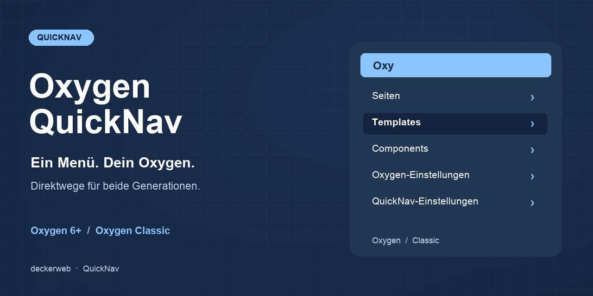

# Oxygen QuickNav

[English](README.md)

## Über das Plugin

Schneller Zugriff auf die Inhalte und Einstellungen, die Du täglich brauchst – für Oxygen und Oxygen Classic. QuickNav wählt den aktiven Builder automatisch und hält die eigenen Einstellungen auch bei deaktiviertem Builder erreichbar.

Version 2.0.0-rc.3 ist eine Testfassung. Navigation: WordPress 6.7+, PHP 7.4+. Mitgelieferte Library: PHP 8.0+. Updater-Anbindung: PHP 8.1+. Oxygen hat eigene Plattformanforderungen.

[FAQ](#faq) · [Änderungsverlauf](#änderungsverlauf) · [GitHub](https://github.com/deckerweb/oxygen-quicknav)

**Inhalt:** [Über das Plugin](#über-das-plugin) · [Auf einen Blick](#auf-einen-blick) · [Installation & Erste Schritte](#installation--erste-schritte) · [Funktionen](#funktionen) · [FAQ](#faq) · [Änderungsverlauf](#änderungsverlauf) · [Projekt & Unterstützung](#projekt--unterstützung)

## Auf einen Blick

- Automatische Erkennung der Generation mit passenden Builder-URLs.
- Seiten, Beiträge und ausgewählte öffentliche Custom Post Types; standardmäßig veröffentlichte Inhalte.
- Templates, Header, Footer und Components in Oxygen; Templates und wiederverwendbare Teile in Classic. Classic bietet außerdem Direktwege zu Stylesheets sowie Export & Import.
- Erkennung der Hersteller-Addons, Formular-Einsendungen, Elementverwaltung und optionale Produktnavigation. Migration Mode wird automatisch aus den registrierten Einstellungen-Tabs übernommen.
- Website-Standardwerte, persönliche Profil-Vorlieben, vorhandene Konstanten und Ziele mit Rechteprüfung.
- Lokale Sprachressourcen für Englisch, Deutsch (Du) und Deutsch (Sie), strukturierter Verlauf und Multisite-Unterstützung.

## Installation & Erste Schritte

1. Installiere die Testfassung oxygen-quicknav.zip unter Plugins → Installieren → Plugin hochladen.
2. Aktiviere QuickNav zusammen mit Deinem unterstützten Oxygen-Builder.
3. Öffne Einstellungen → Oxygen QuickNav und wähle Inhaltstypen, Gruppen, Sortierung und Sichtbarkeit.
4. Öffne Benutzer → Profil für persönliche Sichtbarkeit und Eintragszahl.

## Funktionen

### Automatische Erkennung der Generation mit passenden Builder-URLs.

Automatische Erkennung der Generation mit passenden Builder-URLs.

### Seiten, Beiträge und ausgewählte öffentliche Custom Post Types

Seiten, Beiträge und ausgewählte öffentliche Custom Post Types; standardmäßig veröffentlichte Inhalte.

### Templates, Header, Footer und Components in Oxygen

Templates, Header, Footer und Components in Oxygen; Templates und wiederverwendbare Teile in Classic. Classic bietet außerdem Direktwege zu Stylesheets sowie Export & Import.

### Erkennung der Hersteller-Addons, Formular-Einsendungen, Elementverwaltung und optionale Produktnavigation. Migration Mode wird automatisch aus den registrierten Einstellungen-Tabs übernommen.

Erkennung der Hersteller-Addons, Formular-Einsendungen, Elementverwaltung und optionale Produktnavigation. Migration Mode wird automatisch aus den registrierten Einstellungen-Tabs übernommen.

### Website-Standardwerte, persönliche Profil-Vorlieben, vorhandene Konstanten und Ziele mit Rechteprüfung.

Website-Standardwerte, persönliche Profil-Vorlieben, vorhandene Konstanten und Ziele mit Rechteprüfung.

### Lokale Sprachressourcen für Englisch, Deutsch (Du) und Deutsch (Sie), strukturierter Verlauf und Multisite-Unterstützung.

Lokale Sprachressourcen für Englisch, Deutsch (Du) und Deutsch (Sie), strukturierter Verlauf und Multisite-Unterstützung.

## FAQ

### Wählt QuickNav den passenden Oxygen automatisch?

Ja. Der aktive Builder bestimmt Datenabfragen, Gruppen, Rechte, Einstellungen und Bearbeitungs-URLs. Sind beide Integrationen vorhanden, erhalten sie getrennte Untermenüs. Dadurch werden ansonsten inkompatible Hersteller-Plugins nicht gleichzeitig betreibbar.

### Warum gibt es in Classic keine getrennten Header und Footer?

Classic speichert Templates und wiederverwendbare Teile in ct_template. QuickNav folgt dieser Struktur, statt Header oder Footer anhand des Namens zu vermuten.

### Können Redakteure QuickNav verwenden?

Ein Administrator kann die erforderliche Toolbar-Berechtigung ändern. Jedes Ziel prüft weiterhin WordPress- und Oxygen-Rechte; QuickNav-Sichtbarkeit erteilt keinen Builder-Zugriff.

### Kann ich Entwürfe, Beiträge oder Produkte anzeigen?

Ja. Wähle öffentliche Inhaltstypen und optional unveröffentlichte Inhalte in den Einstellungen. Es erscheinen nur bearbeitbare Inhalte mit Builder-Daten. Produkte benötigen den registrierten Inhaltstyp und passende Benutzerrechte.

### Teilt eine Netzwerkaktivierung meine Einstellungen?

Nein. Standardwerte und persönliche Vorlieben gelten pro Website. Neue Websites verwenden automatisch die Standardwerte. Die gemeinsame Library verwaltet ihren eigenen Website-/Netzwerk-Geltungsbereich.

### Was passiert bei einer Deinstallation mit meinen Daten?

QuickNav-Einstellungen bleiben standardmäßig erhalten. Die optionale Löschung entfernt nur auf den zustimmenden Websites deren QuickNav-Einstellungen und persönliche Vorlieben. Oxygen-Inhalte bleiben erhalten. Library-Daten bleiben bestehen, solange ein anderer eingebetteter Host installiert ist.

### Verbindet sich das Plugin mit externen Diensten?

Der Updater prüft dieses öffentliche GitHub-Repository im WordPress-Updateablauf; GitHub erhält übliche Anfrage-Metadaten. Kein Token ist nötig, Telemetrie kommt nicht hinzu. Der optionale Onlinekatalog der Library ist anfangs aus; seine Aktivierung erlaubt die dokumentierten GitHub-Katalog- und Paketabfragen.

[Fragen nach Themen](docs/FAQ-de.md)

## Änderungsverlauf

### 2.0.0 · 8. Oktober 2026

- **Neu:** Automatische Unterstützung für Oxygen und Oxygen Classic, einschließlich wiederverwendbarer Teile und Hersteller-Addons.
- **Neu:** Website-Einstellungen und persönliche Toolbar-Vorlieben; einstellbare Inhaltstypen, Gruppen, Sortierung und unveröffentlichte Inhalte.
- **Verbessert:** Jedes Ziel berücksichtigt WordPress- und Builder-Rechte. Fehlende Builder pausieren die Navigation sicher.
- **Behoben:** Builder-Erkennung, Einstellungen-Links, Abfragefilter und Builder-URLs bei Unterverzeichnis-Installationen korrigiert.
- **Neu:** Die Oxygen-Classic-Navigation enthält Stylesheets sowie Export & Import an passenden Menüpositionen.
- **Verbessert:** Präzisere Admin-Dashboard-Bezeichnungen, übersichtliche Checkbox-Gruppen, abgestimmte Grafiken und ursprüngliche Ressourcenlinks. Registrierte Oxygen-Einstellungstabs enthalten Migration Mode, sofern verfügbar.
- **Behoben:** Die Aktivierung funktioniert ohne unterstützten Builder; Einstellungen bleiben erreichbar und Hinweise erscheinen innerhalb des WordPress-Admins unter dem vollständigen Header.
- **Sonstiges:** Nutzt die native Toolbar-Anzeige der WordPress-Editoren. Enthält deckerweb Updater 2.1.0 (PHP 8.1+) und Library 0.8.0 (PHP 8.0+); die Navigation bleibt mit PHP 7.4 kompatibel.

### 1.1.0 · 7. April 2025

- **Neu:** Einstellbare Benutzer-IDs und Eintragszahlen, Site-Health-Informationen, deutsche Übersetzungen und Git-Updater-Anbindung.
- **Neu:** Toolbar-Anzeige im Vollbildmodus des Block-Editors.
- **Verbessert:** Toolbar-Darstellung und Navigations-Standardwerte.

### 1.0.0 · 9. März 2025

- **Neu:** Oxygen-6-Toolbar-Navigation für Seiten, Templates, Header, Footer, Components und Einstellungen.
- **Neu:** Verknüpfungen für erkannte Migration-Mode-, Yabe-Webfont- und WPSix-Exporter-Integrationen.

## Projekt & Unterstützung

David Decker – DECKERWEB. QuickNav.

[Issues](https://github.com/deckerweb/oxygen-quicknav/issues) · [Security](SECURITY.md) · [Ko-fi](https://ko-fi.com/deckerweb) · [Buy Me a Coffee](https://buymeacoffee.com/daveshine) · [PayPal](https://paypal.me/deckerweb)

Das Plugin entstand als Fork von [Breakdance Navigator](https://github.com/beamkiller/breakdance-navigator), Peter Kulcsár, © 2024, GPL v2 or later.

Copyright © 2025–2026 David Decker – DECKERWEB. GPL v2 or later. Das bestehende Oxygen-Logo gehört Soflyy. Das neue Navigationssymbol ist eine eigene Vektorgrafik. deckerweb Updater 2.1.0 and Library 0.8.0: © 2026 David Decker – DECKERWEB, GPL-2.0-or-later.
