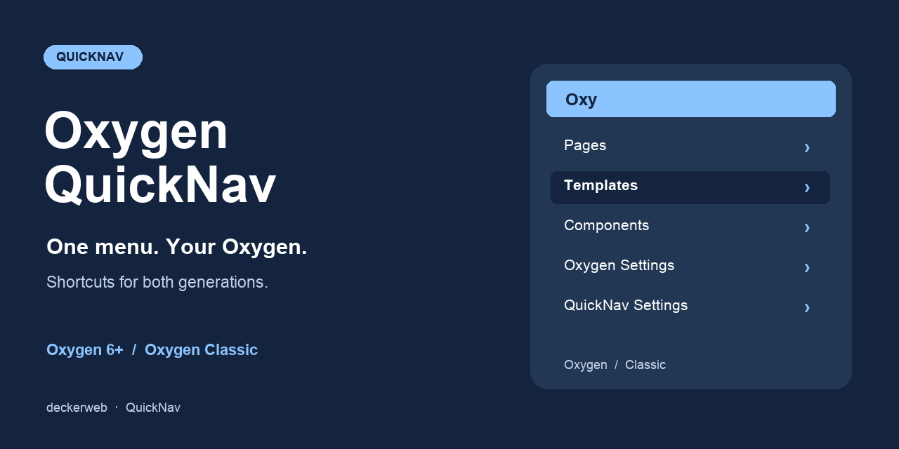

# Oxygen QuickNav

[Deutsch](README-de.md)

## About

Quick access to the content and settings you use every day, for Oxygen and Oxygen Classic. QuickNav chooses the active builder automatically and keeps its own settings available when the builder is inactive.

Version 2.0.0-rc.3 is a test build. Navigation: WordPress 6.7+, PHP 7.4+. Bundled Library: PHP 8.0+. Bundled updater integration: PHP 8.1+. Oxygen has its own platform requirements.

[FAQ](#faq) · [Changelog](#changelog) · [GitHub](https://github.com/deckerweb/oxygen-quicknav)

**Contents:** [About](#about) · [At a Glance](#at-a-glance) · [Installation & First Steps](#installation--first-steps) · [Features](#features) · [FAQ](#faq) · [Changelog](#changelog) · [Project & Support](#project--support)

## At a Glance

- Automatic generation detection and generation-specific builder URLs.
- Pages, posts, and selected public custom post types; published content by default.
- Templates, headers, footers, and components in Oxygen; templates and reusable parts in Classic. Classic also links directly to stylesheets and export/import tools.
- Official add-on detection, form submissions, element management, and optional product navigation.
- Website defaults, personal profile preferences, legacy constants, and permission-aware destinations.
- Local English, German (Du), and German (Sie) resources, structured local history, and Multisite support.

## Installation & First Steps

1. Install the oxygen-quicknav.zip test package under Plugins → Add New → Upload Plugin.
2. Activate QuickNav alongside your supported Oxygen builder.
3. Open Settings → Oxygen QuickNav. Choose content types, groups, sorting, and visibility.
4. Open Users → Profile for personal visibility and item-count preferences.

## Features

### Automatic generation detection and generation-specific builder URLs.

Automatic generation detection and generation-specific builder URLs.

### Pages, posts, and selected public custom post types

Pages, posts, and selected public custom post types; published content by default.

### Templates, headers, footers, and components in Oxygen

Templates, headers, footers, and components in Oxygen; templates and reusable parts in Classic. Classic also links directly to stylesheets and export/import tools.

### Official add-on detection, form submissions, element management, and optional product navigation.

Official add-on detection, form submissions, element management, and optional product navigation.

### Website defaults, personal profile preferences, legacy constants, and permission-aware destinations.

Website defaults, personal profile preferences, legacy constants, and permission-aware destinations.

### Local English, German (Du), and German (Sie) resources, structured local history, and Multisite support.

Local English, German (Du), and German (Sie) resources, structured local history, and Multisite support.

## FAQ

### Does it choose the right Oxygen automatically?

Yes. The active builder determines data queries, categories, permissions, settings, and edit URLs. If both integrations are present, they receive separate submenus. This does not make otherwise incompatible vendor plugins coexist.

### Why are there no separate headers and footers in Classic?

Classic stores templates and reusable parts in ct_template. QuickNav follows that structure instead of guessing a header or footer from its name.

### Can editors use it?

An administrator can change the required toolbar capability. Each destination still checks WordPress and Oxygen permissions; changing QuickNav visibility does not grant builder access.

### Can I show drafts, posts, or products?

Yes. Choose public content types and optionally unpublished content in the settings. Only editable items with builder data appear. Products require their registered post type and user permission.

### Does network activation share my settings?

No. Defaults and personal preferences are scoped to each website. New websites use defaults automatically. The shared Library manages its own website/network scope.

### What happens to my data when I uninstall?

QuickNav settings remain by default. Optional deletion removes only each opted-in website’s QuickNav settings and personal preferences. Oxygen content stays. Library cleanup retains shared data while another embedded host is installed.

### Does it contact external services?

The updater checks this public GitHub repository through WordPress update requests; GitHub receives normal request metadata. No token is required and no telemetry is added. The Library’s optional online catalog starts disabled; enabling it allows its documented GitHub catalog and package requests.

[FAQ by topic](docs/FAQ.md)

## Changelog

### 2.0.0-rc.3 · October 8, 2026 · Test build

- **New:** Oxygen Classic navigation includes Stylesheets and Export & Import in their appropriate menu positions.
- **Improved:** Library 0.8.0 handles activation of the new dual-generation QuickNav directly. Clearer Admin Dashboard labels and separated checkbox rows improve settings readability.
- **Fixed:** Original resource and author links are retained, and admin notices appear below the complete header.

### 2.0.0-rc.2 · October 8, 2026 · Test build

- **Fixed:** Activation remains available when another plugin has already loaded a newer Library. Missing Oxygen 6+ or Oxygen Classic is explained within WordPress admin.

### 2.0.0-rc.1 · October 7, 2026 · Test build

- **New:** Automatic support for Oxygen and Oxygen Classic, including reusable parts and official add-on shortcuts.
- **New:** Website settings and personal toolbar preferences; configurable content types, groups, sorting, and unpublished content.
- **Improved:** Each destination respects WordPress and builder permissions. Missing builders safely pause navigation.
- **Fixed:** Corrected builder detection, settings links, query filters, and builder URLs for subdirectory installations.
- **Misc:** Uses native WordPress editor toolbar visibility. Includes deckerweb Updater 2.1.0 (PHP 8.1+) and Library 0.7.0 (PHP 8.0+); navigation retains PHP 7.4 compatibility.

### 1.1.0 · April 2025

- **New:** Configurable user IDs and item limits, Site Health information, German translations, and Git Updater integration.
- **New:** Toolbar display in block editor fullscreen mode.
- **Improved:** Toolbar styling and navigation defaults.

### 1.0.0 · March 9, 2025

- **New:** Oxygen 6 toolbar navigation for pages, templates, headers, footers, components, and settings.
- **New:** Shortcuts for detected Migration Mode, Yabe Webfont, and WPSix Exporter integrations.

## Project & Support

David Decker – DECKERWEB. QuickNav.

[Issues](https://github.com/deckerweb/oxygen-quicknav/issues) · [Security](SECURITY.md) · [Ko-fi](https://ko-fi.com/deckerweb) · [Buy Me a Coffee](https://buymeacoffee.com/daveshine) · [PayPal](https://paypal.me/deckerweb)

This plugin originated as a fork of [Breakdance Navigator](https://github.com/beamkiller/breakdance-navigator), Peter Kulcsár, © 2024, GPL v2 or later.

Copyright © 2025–2026 David Decker – DECKERWEB. GPL v2 or later. The existing Oxygen logo belongs to Soflyy. The navigation symbol is original vector artwork. deckerweb Updater 2.1.0 and Library 0.8.0: © 2026 David Decker – DECKERWEB, GPL-2.0-or-later.
